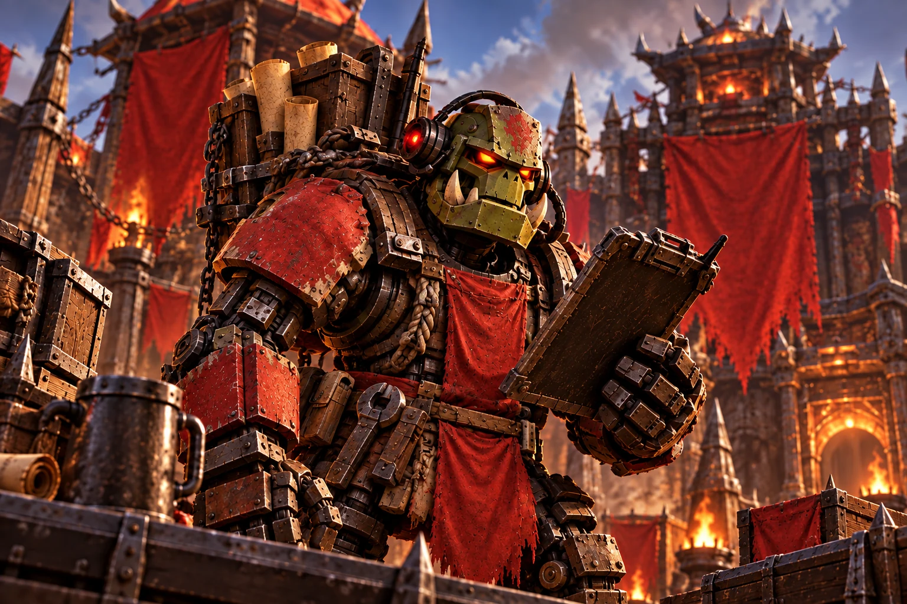
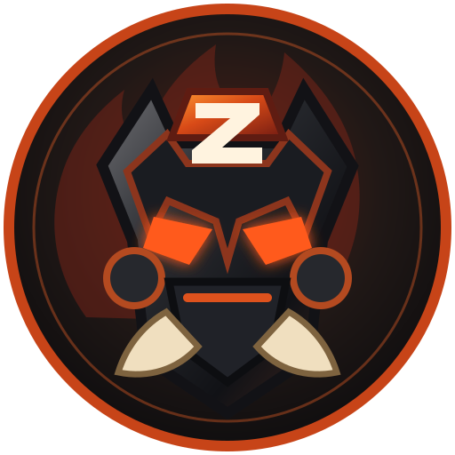

<section class="zb-hero" aria-labelledby="hero-title">
  
  

    

      
Guild operations · Discord

      <h1 id="hero-title">Less admin. More playing.</h1>
      
Your community's extra pair of hands — now with a graphical Guild Command Center.

      
Open ZugBot's Discord Activity for your guild dashboard, event calendar, groups, characters, staff tools, and Tavern games — including Peon Fight Club. Your existing slash commands still work.

      

        <a class="zb-button zb-button-primary" href="discord-activity/">Explore the Discord Activity</a>
        <a class="zb-button" href="https://discord.gg/QjZHFW9gwP" target="_blank" rel="noopener noreferrer">Try ZugBot Live</a>
        <a class="zb-button" href="#features">Explore features</a>
      

      
Built for guilds. Runs inside Discord.

    

  

</section>

<nav class="zb-capabilities" aria-label="Feature guides">
  

    <a href="discord-activity/">Guild Command Center</a>
    <a href="peon-fight-club/">Peon Fight Club</a>
    <a href="planner/">Guild Planner</a>
    <a href="member-guide/">Characters &amp; Profiles</a>
    <a href="member-guide/">Group Coordination</a>
    <a href="member-guide/">Smart Notifications</a>
    <a href="admin-guide/">Guild Administration</a>
  

</nav>

<section class="zb-section zb-planner" id="features" aria-labelledby="planner-title">
  

    

      
01 / Get the guild together

      <h2 id="planner-title">A raid night. A plan. <em>Everyone in the loop.</em></h2>
      
Create a one-time, weekly, or monthly event, let members choose their roles and game-appropriate Modern or Forever linked characters, and watch the roster take shape. ZugBot keeps every Planner card and native Discord Scheduled Event together.

      <ul class="zb-detail-list">
        <li>Tank, Healer, DPS, Bench, Maybe, and Can't Attend</li>
        <li>Modern and Forever character signups with live composition</li>
        <li>Automatic 24-hour and 1-hour reminders</li>
        <li>One-time, weekly, and monthly schedules</li>
      </ul>
      <a class="zb-text-link" href="planner/">Explore Guild Planner</a>
    

    <figure class="zb-planner-preview">
      <figcaption>Example Planner card</figcaption>
      
# raid-and-events

      

        
        <strong>ZugBot</strong>APP
      

      

        
Guild Planner · Raid

        <h3>Friday Raid Night</h3>
        
Bring your flasks. We've got bosses to pull.

        

Starts<strong>Friday · 8:00 PM</strong>

Composition<strong>2 Tank · 4 Healer · 11 DPS</strong>

        

<strong>Tanks</strong>@Member (Character) · @Member (Character)

<strong>Healers</strong>@Member (Character) · +3 more

<strong>DPS</strong>@Member (Character) · +10 more

      

      
TankHealerDPSBenchMaybeCan't Attend

      
Illustrative example. Actual events run in your Discord server.

    </figure>
  

</section>

<section class="zb-section zb-tools" aria-labelledby="tools-title">
  

    

More than slash commands
<h2 id="tools-title">One bot. A lot less busywork.</h2>

    

      <article class="zb-tool">02
<h3>Characters &amp; Profiles</h3>
Link Modern WoW and WoW: Forever characters from one private panel. Battle.net verification is optional, and manual links can be verified later.
<a class="zb-text-link" href="verification/">Verification &amp; privacy</a>
</article>
      <article class="zb-tool">03
<h3>Group Coordination</h3>
Build role-based groups with linked characters, persistent cards, and practical owner controls right where members already talk.
<a class="zb-text-link" href="commands/">See group commands</a>
</article>
      <article class="zb-tool">04
<h3>Smart Notifications</h3>
Reach members whose role and key-range preferences match an open group, without turning every opportunity into an everyone ping.
<a class="zb-text-link" href="member-guide/">Configure notifications</a>
</article>
      <article class="zb-tool">05
<h3>Guild Administration</h3>
Open the permission-controlled Leadership workspace for member information, reports, onboarding, announcements, and eligible server tools.
<a class="zb-text-link" href="admin-guide/">Open the admin guide</a>
</article>
      <article class="zb-tool">06
<h3>Peon Fight Club</h3>
Challenge a guildmate to a D20 tavern duel, save every round in your Combat Journal, and chase a 24-hour Champion title. Cancel or restore a lost battle message from the Activity.
<a class="zb-text-link" href="peon-fight-club/">How Peon Fight Club works</a>
</article>
      <article class="zb-tool">07
<h3>Fun &amp; Brewfest</h3>
Roll dice, flip coins, send beers, and start a ten-claim Brewfest Keg. Choose exactly where ZugBot posts.
<a class="zb-text-link" href="discord-activity/">Explore Fun</a>
</article>
      <article class="zb-tool">08
<h3>Discord Activity</h3>
Dashboard, calendar, groups, character tools, and staff operations share one Guild Hall inside Discord, with permission-aware navigation.
<a class="zb-text-link" href="discord-activity/">Open the Activity guide</a>
</article>
    

  

</section>

<section class="zb-section zb-start" aria-labelledby="start-title">
  

    

Put ZugBot to work
<h2 id="start-title">Your guild has enough bosses to deal with.</h2>
Launch the Guild Command Center, link your characters, coordinate a group, or challenge somebody in Peon Fight Club. Or keep using the familiar slash commands. ZugBot runs inside Discord.

<a class="zb-button zb-button-primary" href="discord-activity/">Read the Activity guide</a><a class="zb-button" href="https://discord.gg/QjZHFW9gwP" target="_blank" rel="noopener noreferrer">Try ZugBot Live</a><a class="zb-button" href="commands/">Browse commands</a>

    

<strong>Battle.net sign-in is optional and stays on Battle.net.</strong>When you choose verification, ZugBot sends your browser to Battle.net's own sign-in page. You can always link characters manually instead.

<strong>ZugBot keeps only what it needs.</strong>It remembers which characters Battle.net confirmed for your Discord account and when the 30-day confirmation ends. It does not save your Battle.net password or temporary sign-in information.

<strong>Your guild stays your guild.</strong>Each server keeps its own setup, leadership roles, and activity information.

<strong>Ready after a restart.</strong>Your active groups and event cards come back after ZugBot restarts.

  

</section>

<section class="zb-support" id="support" aria-labelledby="support-title">
  

Independent development
<h2 id="support-title">Help keep ZugBot moving.</h2>
Support covers infrastructure, development tools, and the next round of guild features.

<a class="zb-button" href="https://buymeacoffee.com/ZugBot" target="_blank" rel="noopener noreferrer">One-time support</a><a class="zb-text-link" href="https://patreon.com/ZugBot" target="_blank" rel="noopener noreferrer">Monthly support</a>

</section>

<footer class="zb-footer">
<a class="zb-footer-brand" href="./"><strong>ZugBot</strong></a>
Guild operations for Discord.
<nav aria-label="Footer"><a href="getting-started/">Getting Started</a><a href="discord-activity/">Discord Activity</a><a href="peon-fight-club/">Peon Fight Club</a><a href="verification/">Verification &amp; Privacy</a><a href="commands/">Commands</a><a href="troubleshooting/">Get help</a><a href="privacy/">Privacy Policy</a><a href="terms/">Terms of Service</a><a href="mailto:support@zugbot.net">support@zugbot.net</a></nav>
</footer>
